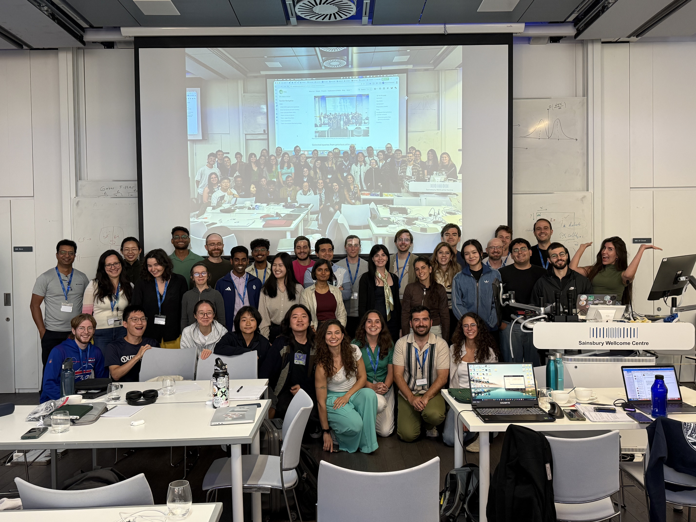

# Open Software Summer School


We are excited to announce the third **NIU Open Software Summer School**, taking
place on **August 9-20 2027** at the [Sainsbury Wellcome Centre](https://maps.app.goo.gl/CzWFFjXJZwX87aMj6) 
in **London, UK**. This event will bring together researchers, developers, and users of open-source software for some hands-on training, community-building and hacking.

[The 2025 event](2025/index) (known as Open Software Week) brought together 44 attendees from 12 countries to learn 
about open-source approaches for handling large images, processing microscopy data and analysing video behavioural data. 

[The 2026 event](2026/index) expanded to two weeks, adding a new *Extracellular Electrophysiology* track alongside
additional satellite events, guest lectures and opportunities for researchers to present their own work.
It welcomed 51 attendees from 16 countries. 

:::{admonition} Applications are now open!
:class: info
Please apply using [this form](https://forms.gle/FSFNQ8tLL1yQGW3x5).
You can see the [application questions](2027/application_questions) in advance to prepare your answers.

If you have any questions, please ask on our [Zulip chat](https://neuroinformatics.zulipchat.com/#narrow/channel/542225-Open-Software-Summer-School). 
Alternatively, please <a href="mailto:adam.tyson@ucl.ac.uk ?subject=Open Software Summer School">email Adam Tyson</a>.
:::

(target-2027-osss-schedule)=
## Schedule

There are four tracks targeted to different audiences.
We encourage you to read each track's description and choose the one(s) that best fits your interests. 

:::: {grid} 1 1 2 4

:::{grid-item-card} {fas}`video;sd-text-secondary` Animals in Motion
:img-top: /_static/osw_images/animals-in-motion-card.png
:link: track-animals-in-motion-2027
:link-type: ref

Use open-source tools to track
and analyse animal motion from video footage.

:::

:::{grid-item-card} {fas}`layer-group;sd-text-primary` Large Array Data
:img-top: /_static/osw_images/big-imaging-data-card.png
:link: track-large-array-data-2027
:link-type: ref

Learn about strategies and use open source tools to process large array data (e.g. imaging, videos, electrophysiology,...)

:::

:::{grid-item-card} {fas}`brain;sd-text-warning` BrainGlobe
:img-top: /_static/osw_images/brainglobe-card.png
:link: track-brainglobe-2027
:link-type: ref

Use the BrainGlobe ecosystem of computational neuroanatomy tools
to analyse whole-brain microscopy datasets.
:::

:::{grid-item-card} {fas}`bolt;sd-text-info` Extracellular Electrophysiology
:img-top: /_static/osw_images/ephys-card.png
:link: track-extracellular-ephys-2027
:link-type: ref

Using open source tools to process and analyse large extracellular electrophysiology data (e.g. from silicon probes)
:::

::::

:::{admonition} Registration
:class: info
You may register for week 1, week 2 or both. However, you can only register for one track per week, i.e:

- **Week 1**: either *Animals in Motion* or *Large Array Data*.
- **Week 2**: either *BrainGlobe* or *Extracellular Electrophysiology*.
:::

## Key Dates

| Date              | Event |
|-------------------| --- |
| December 2026     | Applications open |
| January 31st 2027 | Applications close |
| March 2027        | Applicants are notified of acceptance |
| July 2027         | Optional preparatory month begins |
| August 9-13 2027  | Week 1: *Animals in Motion* & *Large Array Data* |
| August 16-20 2027 | Week 2: *BrainGlobe* & *Extracellular Electrophysiology* |


## Symposium
On the first day of each track (Monday afternoon), there will be a symposium, shared with participants of the other track held that week. 
All attendees will be expected to present a poster describing their past, present or planned work. 

(target-preparatory-month-2027)=
## Preparatory month
All four tracks require a basic knowledge of scientific Python programming. If you don't have this background, that's 
totally fine, we will be running an asynchronous preparatory course in the month before the summer school. Training 
materials and exercises will be shared with participants, and OSSS instructors will be available to answer any questions.

**This preparatory course is mandatory for those without Python experience, and requires a minimum of four hours per week 
commitment for four weeks prior to the summer school**

## Fees
- **Academic or self funding**: £450 per week
- **Industry**: £900 per week

Fees include all materials needed, and lunch/refreshments each day.

### Financial Assistance
A number of fee waivers will be available to applicants who would not otherwise be able to attend the summer school. 
A limited number of travel stipends will also be available, but we encourage applicants to apply for 
[independent travel funding](funding).


## Feedback from previous summer schools


**Participants (having a great time) after presenting their collaborative work in 2026** 

### Selected quotes from 2026 attendees

> The environment is truly encouraging to work on your project and to learn new things!

> The best thing was to talk to other people about our challenges and find solutions together.

> Fantastic content! Very accessible and explained in a great manner.

> Genuinely, I think I benefitted a lot from relieving the daunting feeling of working with large arrays [...] I think this course was, at base level, great for just breaking this barrier.

> It has honestly been the best thing I have done in my PhD. 

### Selected quotes from 2025 attendees
> Sparked a bit of a eureka moment after months of agonising over how to analyse my data!

> Thank you again for organizing this amazing event

> My whole PhD feels doable now!

> The heterogeneity of the attendees was truly enriching.

> Atmosphere was very friendly and down to earth.

## Funding

The Open Software Summer School is supported by the [Sainsbury Wellcome Centre](https://www.sainsburywellcome.org/) and [The Neuro – Irv and Helga Cooper Foundation Open Science Prize](https://www.mcgill.ca/neuro/open-science/open-science-awards-and-prizes/neuro-irv-and-helga-cooper-foundation-open-science-prizes).


```{toctree}
:maxdepth: 1
:caption: Index
:hidden:

funding
2025/index
2026/index
2027/application_questions
2027/animals-in-motion
2027/large-data
2027/brainglobe
2027/extracellular-electrophysiology
```
